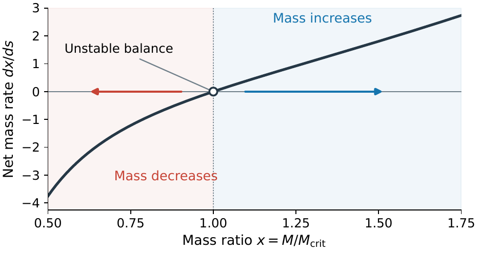
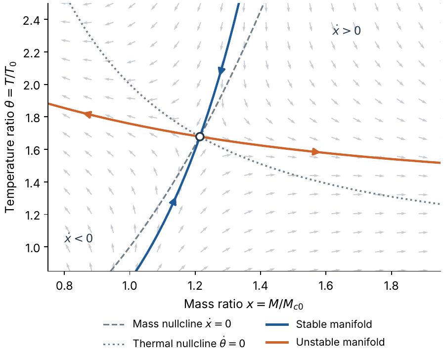

# Can a Microscopic Black Hole Be Held at Constant Mass?

**Stability of the Hawking–Bondi balance in fixed and thermally coupled media**

**Paper:** [Read the PDF](full-paper/main.pdf) (13 pages)  
**Author:** Emir Anaraly uulu, Bishkek, Kyrgyz Republic · [anarem1004@gmail.com](mailto:anarem1004@gmail.com)

A microscopic black hole loses mass by Hawking evaporation and can regain it by accreting the surrounding gas. This project asks whether the two processes can hold its mass constant, and answers the question in two steps.

1. **Fixed medium.** Bondi accretion and blackbody Hawking evaporation give $\dot M=AM^2-B/M^2$. The single balance mass $M_{\rm crit}=(B/A)^{1/4}$ is **unstable**, and the equation has an exact implicit solution that gives evaporation and growth times on either side.
2. **Thermal feedback.** Letting the hole's radiation heat the gas, so that the Bondi rate falls as $T^{-3/2}$, shifts the balance to a hotter, heavier state, but the Jacobian determinant is negative for every positive heating and cooling strength: the equilibrium is a **saddle**. A sign theorem extends this to any one-zone model in which heating falls with mass, accretion falls with temperature and cooling rises with temperature.

The physical reason is the sign of the feedback. An ordinary accreting black hole radiates more when it accretes more, which limits further accretion. A Hawking-powered hole radiates more when it *loses* mass, so heating suppresses accretion exactly when accretion is needed.

<p align="center">
  
  
</p>
<p align="center"><em>Left: the fixed-medium balance repels perturbations. Right: with thermal feedback the balance becomes a saddle.</em></p>

## How the project developed

| Date | Stage | Where |
| --- | --- | --- |
| April 2026 | Olympiad problem on the Hawking–Bondi balance, written for the Kyrgyz national physics competition and used in IPhO-2026 team selection | — |
| May–September 2026 | **Paper I:** full analysis of the fixed medium, exact solution, timescales | [`paper/`](paper/) |
| September–October 2026 | **Paper II:** thermal feedback, saddle theorem, plasma-scale estimates | [`thermal-feedback/`](thermal-feedback/) |
| October 2026 | **Combined paper** presenting both steps as one study | [`full-paper/`](full-paper/) |

## Repository layout

| Path | Contents |
| --- | --- |
| [`full-paper/`](full-paper/) | Combined manuscript (`main.pdf`, `main.tex`) |
| [`paper/`](paper/) | Paper I: manuscript, LaTeX source, `reproduce.py`, results and figures |
| [`thermal-feedback/`](thermal-feedback/) | Paper II: manuscript, LaTeX source, `reproduce.py`, results and figures |
| [`requirements.txt`](requirements.txt) | Python package versions |

## Reproduce

Use Python 3.11 or newer and a LaTeX installation with `pdflatex`. From the repository root:

```bash
python3 -m venv .venv
source .venv/bin/activate          # Windows: .venv\Scripts\activate
python -m pip install -r requirements.txt
(cd paper && python reproduce.py)
(cd thermal-feedback && python reproduce.py)
cd full-paper
pdflatex -interaction=nonstopmode -halt-on-error main.tex
pdflatex -interaction=nonstopmode -halt-on-error main.tex
```

The combined paper reads its figures from `paper/figures/` and `thermal-feedback/figures/`. Each script checks its own results: Paper I compares numerical trajectories with the exact solution, and Paper II verifies the sign of the determinant and the eigenvalue inequalities over a parameter grid.

## Scope

The results are exact statements about idealized models: a photon-blackbody Hawking luminosity, steady Bondi accretion and, in the second step, a one-zone thermal reservoir. They are not predictions for a realizable energy source. The paper discusses what a physical model would additionally require.
